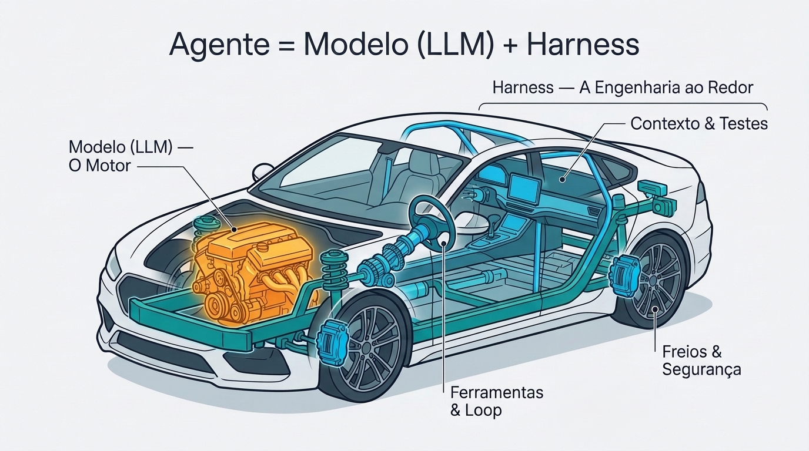

# IA no Terminal & Harness Engineering (Cofre Obsidian)

Cofre do Obsidian com estudo estruturado, ilustrações, diagramas e apresentação sobre **IA no terminal e *Harness Engineering* voltado para código** — com foco em **fundamentos, código aberto e independência de fornecedor (*anti-vendor lock-in*)**.

> **Tese central:** `Agente = Modelo (LLM) + Harness`  
> Um agente de código confiável não depende só da capacidade bruta do modelo, mas da engenharia ao redor dele: contexto, ferramentas, loop de verificação, sensores objetivos e travas de segurança.



---

## O que você encontra neste repositório

Este cofre usa o agente open source minimalista **Pi** (`pi.dev`) como **"raio-x"** para abrir o capô de um harness de código sem caixas-pretas, encerrando com um caso prático real construído em cima dele: o **`pi-father-spinner`**.

### Formatos de Apresentação
O mesmo conteúdo está disponível em dois formatos nativos do Obsidian para apresentação:

1. **Quadro Visual (Canvas):** [`Apresentacao - Visual (Canvas).canvas`](Apresentacao%20-%20Visual%20%28Canvas%29.canvas)  
   Storyboard horizontal organizado pelos 5 blocos, combinando imagens, diagramas e pontos de fala.
2. **Slides em Markdown:** [`Apresentacao - Slides.md`](Apresentacao%20-%20Slides.md)  
   Deck enxuto com separadores `---` pronto para o plugin nativo **Slides** do Obsidian (já habilitado em `.obsidian/core-plugins.json`).

---

## Estrutura do Cofre

- [`00 - Mapa de Estudo e Roteiro.md`](00%20-%20Mapa%20de%20Estudo%20e%20Roteiro.md) — Índice mestre com o roteiro completo dos 5 blocos.
- `notas/` — Notas de apoio aprofundadas (adequadas para times mistos em tecnologia):
  1. [`01 - Do Chat ao Terminal e os Pioneiros.md`](notas/01%20-%20Do%20Chat%20ao%20Terminal%20e%20os%20Pioneiros.md) — Evolução até a CLI, reconhecimento à **Anthropic & Claude Code** como pioneiros do *Harness Engineering* e por que evitar *vendor lock-in*.
  2. [`02 - O que e Harness Engineering e o Raio-X com Pi.md`](notas/02%20-%20O%20que%20e%20Harness%20Engineering%20e%20o%20Raio-X%20com%20Pi.md) — Equação `Agente = Modelo + Harness`, paralelo histórico do motor estacionário (Lenoir/Otto) ao automóvel (Benz/Daimler), eficiência (*"sem Ferrari na padaria"*, cidade vs. *off-road*) e escolha do Pi.
  3. [`03 - Anatomia do Harness por Dentro (Raio-X do Pi).md`](notas/03%20-%20Anatomia%20do%20Harness%20por%20Dentro%20%28Raio-X%20do%20Pi%29.md) — Camadas `pi-ai`, `pi-agent-core`, compactação de contexto, *system prompt* `< 1.000 tokens` e as **4 ferramentas núcleo** (`read`, `write`, `edit`, `bash`).
  4. [`04 - Extensibilidade, Guardrails e Engenharia de Contexto.md`](notas/04%20-%20Extensibilidade%2C%20Guardrails%20e%20Engenharia%20de%20Contexto.md) — `AGENTS.md`, `SYSTEM.md`, *Skills*, extensões TypeScript, *hooks* de segurança, testes como sensores objetivos e o **Efeito Escher** (auto-extensão e auto-correção).
  5. [`05 - Caso Pratico (pi-father-spinner), Modos e Papel do Time.md`](notas/05%20-%20Caso%20Pratico%20%28pi-father-spinner%29%2C%20Modos%20e%20Papel%20do%20Time.md) — Modos do Pi (TUI, Print/JSON, RPC, SDK), estudo de caso real com `pi-father-spinner`, checklist *agent-ready* e o novo papel do time.
- `imagens/` — **8 recursos visuais** (5 ilustrações editoriais em `.jpg` e 3 diagramas vetoriais em `.svg`):
  - `evolucao-chat-ao-terminal.jpg`
  - `metafora-carro-harness.jpg`
  - `carro-certo-por-terreno.jpg`
  - `evolucao-motor-ao-automovel.jpg`
  - `arquitetura-pi-harness.svg`
  - `extensibilidade-guardrails-pi.svg`
  - `escher-harness-autoextensao.jpg`
  - `caso-pratico-pi-father-spinner.svg`

---

## Como Abrir no Obsidian

1. Clone este repositório:
   ```bash
   git clone <url-do-seu-repositorio>
   ```
2. No Obsidian, selecione **"Abrir pasta como cofre"** (*Open folder as vault*) apontando para o diretório clonado.
3. Comece por [`00 - Mapa de Estudo e Roteiro.md`](00%20-%20Mapa%20de%20Estudo%20e%20Roteiro.md), navegue pelo [`Apresentacao - Visual (Canvas).canvas`](Apresentacao%20-%20Visual%20%28Canvas%29.canvas) ou abra [`Apresentacao - Slides.md`](Apresentacao%20-%20Slides.md) e execute **Slides: Iniciar apresentação** pela paleta de comandos (`Ctrl/Cmd + P`).
